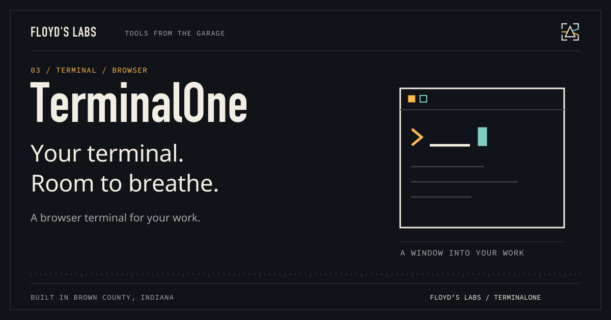
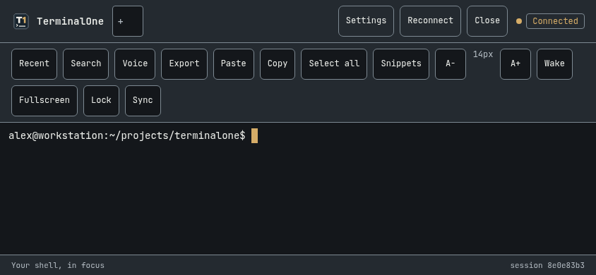

# TerminalOne



**Your shell. A browser. Some breathing room.**

A local browser terminal with a real PTY, session resume, themes, keyboard tools, and a responsive interface. Built at Floyd’s Labs: one garage, two black cats, and tools that have to earn the desk space.

[Download v1.0.2](https://github.com/CaptainPhantasy/TerminalOne/releases/tag/v1.0.2) · [Report a bug](https://github.com/CaptainPhantasy/TerminalOne/issues) · [Floyd’s Labs](https://floydslabs.com)

## Get it running

Requirements: **Node.js 22.x and npm; macOS or Linux**.

Download `terminalone-1.0.2.tgz`, unpack it, and install dependencies:

```sh
mkdir terminalone && tar -xzf terminalone-1.0.2.tgz -C terminalone
cd terminalone/package
npm ci --omit=dev
npm run doctor
npm start
```

Open `http://localhost:11001`. The server binds to `127.0.0.1` and rejects untrusted Host headers and cross-site HTTP/WebSocket origins. A terminal can run commands with your account's permissions. Keep it local. Network access requires a separately configured authenticated tunnel or proxy; the package does not provide remote authentication.

### Connect from a tablet or phone

First configure an HTTPS tunnel or proxy that requires you to sign in before it forwards **any** request, including WebSocket connections. Then start TerminalOne with its exact public address:

```sh
TERMINALONE_TRUSTED_ORIGINS=https://terminal.example.com npm start
```

Open that address on your tablet or phone and sign in through your proxy. The proxy must forward to `http://127.0.0.1:11001`, preserve the public `Host` header and browser `Origin`, and support WebSocket upgrades. Separate multiple allowed HTTPS addresses with commas. Wildcards and plain HTTP remote addresses are rejected. The server still listens only on this computer; this setting allows an address and does not add a sign-in system. With no setting, only local addresses are allowed. Use `TERMINALONE_HEALTH_URL=http://localhost:11001/health` with `t1` when its browser URL points through a sign-in page.

Session resume keeps detached shells for up to five minutes. Browser settings persist locally. Voice transcription is optional and requires a compatible external STT command; it is not a bundled speech model. If a native module needs repair, run `npm run repair`.

For herdr on iPhone or iPad, tap **Ctrl+b** in the bottom key bar to send Control plus lowercase b immediately. You can also open **Snippets** and tap **Ctrl+b** there. No keyboard switch or Enter press is needed.

### Open it like a desktop app (macOS)

From a source checkout on macOS, run `bash scripts/install-service.sh` to install the `t1` launcher and TerminalOne.app. The launcher opens the UI only after health is confirmed, then falls back to direct local startup if launchd is unavailable. Startup diagnostics go to `~/Library/Logs/TerminalOne/local-launch.err.log`.

## A little more room



On short touch screens, **Tools** opens the secondary controls without taking over the shell. **Ctrl+b** and **Voice** stay in the bottom key bar. Paper and graphite palettes keep the chrome quiet; the terminal does the talking.

## What is in the box

The release includes `terminalone-1.0.2.tgz`, source where applicable, and `SHA256SUMS.txt`. Use the tagged release's named assets for installation; GitHub's automatic source archives are snapshots. Verify a download with `shasum -a 256 -c SHA256SUMS.txt` after downloading the matching files.

## Show the work

`npm ci` installs development dependencies. `npm test` covers request boundaries, input handling, browser smoke behavior, resume/mobile features, voice transport, and responsive layouts. A fresh release install is separately started and checked through HTTP and WebSocket. External STT and remote access are not verified integrations.

## Contribute or get help

Open an issue with your platform, version, command, and a minimal reproduction. Keep credentials and personal transcripts out of reports. See [CONTRIBUTING.md](CONTRIBUTING.md) and [SECURITY.md](SECURITY.md).

## Why We Use the MIT License

TerminalOne is MIT licensed, while our standalone engines and runtimes (LGCY, FatChin,
RATBAG, JEVRuntime and wsdash) use the AGPL-3.0. If you are comparing our repositories,
here is the line we draw:

- **Drop-In Primitive:** TerminalOne is a small, self-contained terminal surface: a real
  PTY behind a browser interface. You can run it as is, fork it, or wire it into your
  own desktop, web or CLI setup, open source or commercial, without license boundary
  friction.
- **Clear Line Between Primitives and Engines:** At Floyd's Labs / Legacy AI, we release
  thin integration primitives and interface building blocks under MIT so you can use
  them anywhere. Our standalone engines and foundational runtimes use the AGPL-3.0, so
  hosted commercial forks contribute their improvements back.

Keep the copyright and license notice with your copy and you are set. See
[`LICENSE`](LICENSE) for the full terms.

---

Built with intent. Bella checks the keyboard. Bowser watches the router.
